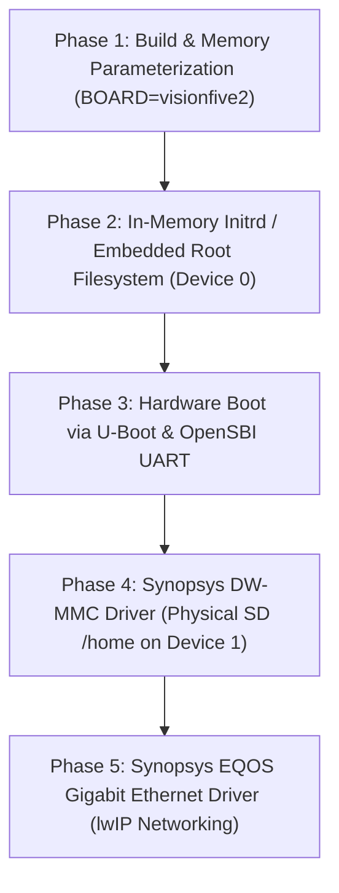

# Technical Design: StarFive VisionFive 2 (JH7110) Hardware Port

## 1. Overview & Goals

This document specifies the technical architecture, driver requirements, memory layout, and deployment process for porting **dmaOS** to the **StarFive VisionFive 2 (VF2)** single-board computer powered by the **StarFive JH7110** SoC.

Building upon our 64-bit RISC-V (`rv64imac` / SV39) port, this milestone transitions dmaOS from a purely emulated environment (QEMU `virt`) to bare-metal hardware execution while preserving backward compatibility with QEMU.

---

## 2. Hardware Architecture & SoC Specifications

### 2.1 StarFive JH7110 SoC Summary
- **Main Cores**: 4x SiFive U74 RV64GC (RV64IMAFDC) cores running at up to 1.5 GHz.
- **Monitor Core**: 1x SiFive S7 RV64IMAC core.
- **L1 Cache**: 32 KB I-Cache + 32 KB D-Cache per U74 core.
- **L2 Cache**: 2 MB shared L2 cache.
- **System Memory**: 4 GB or 8 GB LPDDR4 (physical base address: `0x40000000`).
- **Privilege Architecture**: Standard RISC-V Machine (M), Supervisor (S), and User (U) modes.

### 2.2 Memory Map: QEMU `virt` vs. VisionFive 2

| Region / Peripheral | QEMU `virt` (RV64) | StarFive JH7110 (VF2) | Description |
|---|---|---|---|
| **DRAM Physical Base** | `0x80000000` (2 GiB) | `0x40000000` (1 GiB) | Physical base of system RAM |
| **Default Kernel Load Base** | `0x80200000` | `0x40200000` | Address where OpenSBI/U-Boot jumps to OS |
| **PLIC (Interrupt Controller)**| `0x0c000000` | `0x0c000000` | Platform-Level Interrupt Controller |
| **UART0 Console** | `0x10000000` (16550A) | `0x10000000` (Synopsys DW 8250) | Serial console (Header pins 8/10, 115200 baud) |
| **SD Card Controller** | VirtIO Block (`0x10001000`) | `0x16010000` (DesignWare MMC) | SDIO host controller for microSD / eMMC |
| **Gigabit Ethernet (GMAC0)** | VirtIO Net (`0x10004000`) | `0x16030000` (DesignWare EQOS) | GMAC 0 (Motorcomm YT8531C PHY) |
| **Gigabit Ethernet (GMAC1)** | N/A | `0x16040000` (DesignWare EQOS) | GMAC 1 (Motorcomm YT8531C PHY) |
| **System Clock & Reset (CRG)** | N/A | `0x13020000` / `0x17000000` | Clock gating & reset registers |

---

## 3. Memory & Kernel Relocation Architecture

### 3.1 Linker Script Parameterization
The kernel linker script (`kernel/kernel.ld`) will support board-level physical relocation:

```ld
/* Configurable via preprocessor or Makefile BOARD flag */
#ifdef BOARD_VISIONFIVE2
    RAM_START = 0x40000000;
    KERNEL_START = 0x40200000;
#else
    RAM_START = 0x80000000;
    KERNEL_START = 0x80200000;
#endif
```

### 3.2 Page Frame Allocator (`page.c`)
- **Memory Probing**: The physical page allocator initializes starting from `__free_ram_start` up to available physical RAM (configurable, e.g., 256 MiB pool or probed via Device Tree / boot arguments).
- **Direct Mapping**: The kernel continues to identity-map physical RAM into the supervisor page table during initial boot.

---

## 4. Storage & Two-Tier Filesystem Architecture

dmaOS enforces a strict separation between immutable read-only system executables (Device 0) and persistent user storage (Device 1, mounted at `/home`).

### 4.1 Two-Tier Layout on Hardware

```
+-------------------------------------------------------------------------------+
|                             Physical microSD Card                             |
+-------------------+-----------------------------+-----------------------------+
| Raw Boot Sectors  | Partition 1 (FAT32, ~64MB)  | Partition 2 (Raw dmaOS FS)  |
| - SPL             | - kernel.bin (w/ embedded   | - Persistent /home data     |
| - OpenSBI/U-Boot  |   read-only root disk.img)  |   (Device 1)                |
| - uEnv.txt /      |                             | - Formatted with host mkfs  |
|   boot.scr        |                             |   from data.img             |
+-------------------+-----------------------------+-----------------------------+
```

### 4.2 Device 0: In-Memory Initrd / Embedded Root Filesystem
- **Concept**: The read-only root image (`disk.img`, containing `/bin/sh`, `/bin/doom`, `doom1.wad`, `/bin/cat`, configs) is either:
  1. Embedded directly into `kernel.bin` via `llvm-objcopy -Ibinary`, or
  2. Loaded as an initrd into RAM by U-Boot at `0x46000000`.
- **Implementation**:
  - `read_device(0, buf, sector)` reads directly from RAM: `memcpy(buf, initrd_base + sector * SECTOR_SIZE, SECTOR_SIZE)`.
  - `write_device(0, buf, sector)` returns `-EROFS` (read-only filesystem).
- **Benefits**:
  - Near-zero latency file loading for games and executables.
  - Zero wear on flash storage.
  - Immunity to filesystem corruption from sudden power loss.
  - Immediate OS bringup on hardware before SD card drivers are completed.

### 4.3 Device 1: Physical SD Card Persistent Partition
- **Implementation**:
  - Driven by the **Synopsys DW-MMC (DesignWare Mobile Storage)** hardware driver.
  - Translates sector requests `read_device(1, buf, sector)` and `write_device(1, buf, sector)` to physical block commands on the SD card starting at Partition 2's LBA offset.
- **Host Flashing Workflow**:
  - Host compiles `data.img` using `bin/mkfs`.
  - Flashed to Partition 2 via `dd if=build/rv64/data.img of=/dev/sdX2 bs=1M status=progress`.

---

## 5. Hardware Driver Specifications

### 5.1 Console & UART
- **Mechanism**: dmaOS utilizes standard OpenSBI extension calls (`sbi_call(..., FID=0, EID=1)` for console putchar and getchar, or SBI DBCN Debug Console Extension).
- **Hardware Routing**: OpenSBI on the JH7110 automatically routes console I/O to UART0 (TX = Pin 8, RX = Pin 10 on the 40-pin GPIO header) at 115200 baud, 8N1.
- **Driver Status**: **100% Functional immediately with zero driver changes.**

### 5.2 Synopsys DesignWare MMC (DW-MMC) SD Card Driver
Located at physical MMIO base `0x16010000`.

#### Key MMIO Registers:
- `CTRL (0x00)`: Controller reset, FIFO reset, DMA enable.
- `PWREN (0x04)`: Power enable for SD bus.
- `CLKDIV (0x08)` & `CLKENA (0x10)`: Clock divider and clock enable.
- `TMOUT (0x14)`: Data and response timeout counters.
- `CTYPE (0x18)`: Card bus width (1-bit during init, 4-bit for high-speed transfers).
- `BLKSIZ (0x1C)`: Block size (512 bytes for standard SDHC/SDXC).
- `BYTCNT (0x20)`: Byte count for data transfers.
- `CMD (0x24)`: Command index, start command bit, response expected, data transfer flags.
- `CMDARG (0x28)`: 32-bit command argument.
- `RESP0..3 (0x30..0x3C)`: Command response words.
- `RINTSTS (0x44)` / `MINTSTS (0x40)`: Raw and masked interrupt status flags (Command Done, Data Transfer Over, Error flags).
- `DATA (0x100..0x200)`: 32-bit FIFO buffer data access port.

#### Card Initialization Flow:
1. Power cycle and clock configuration (start at 400 kHz identification clock).
2. Issue `CMD0` (GO_IDLE_STATE) to reset SD card.
3. Issue `CMD8` (SEND_IF_COND) with `0x1AA` to verify 3.3V voltage range and PCIe/SD check pattern.
4. Loop `ACMD41` (APP_CMD -> SD_SEND_OP_COND) with HCS (High Capacity Support) bit set until card ready (busy bit cleared, CCS bit checked for SDHC/SDXC block addressing).
5. Issue `CMD2` (ALL_SEND_CID) to read card identification.
6. Issue `CMD3` (SEND_RELATIVE_ADDR) to obtain card RCA (Relative Card Address).
7. Issue `CMD7` (SELECT_CARD) with RCA to place card in Transfer State.
8. Switch clock divider to 25 MHz or 50 MHz high speed.
9. Issue `ACMD6` (SET_BUS_WIDTH) to switch from 1-bit to 4-bit bus mode.

#### Block Read/Write Flow:
- **Read Sector**:
  1. Write `BLKSIZ = 512`, `BYTCNT = 512`.
  2. Write `CMDARG = sector_number`.
  3. Send `CMD17` (READ_SINGLE_BLOCK) with Data Expected bit set in `CMD`.
  4. Wait for `DTO` (Data Transfer Over) or read 128 words (512 bytes) from the FIFO `DATA` register.
- **Write Sector**:
  1. Write `BLKSIZ = 512`, `BYTCNT = 512`.
  2. Write `CMDARG = sector_number`.
  3. Send `CMD24` (WRITE_SINGLE_BLOCK) with Write & Data Expected flags set.
  4. Stream 128 words into the FIFO `DATA` register and poll for `DTO`.

---

### 5.3 Synopsys DesignWare EQOS Gigabit Ethernet MAC (GMAC0/1)
Located at physical MMIO base `0x16030000` (GMAC0) and `0x16040000` (GMAC1).

#### Architecture:
- **MAC**: Synopsys DesignWare Ethernet Quality of Service (EQOS) controller.
- **PHY**: Motorcomm YT8531C Gigabit Ethernet Transceiver connected via RGMII interface.
- **Management Interface**: MDIO (Management Data Input/Output) on the MAC used to configure PHY speed, duplex, and auto-negotiation (Registers 0x00 MII_BMCR, 0x01 MII_BMSR, 0x09 MII_CTRL1000).
- **DMA Engine**:
  - Ring buffer of Transmit Descriptors (`TX_DESC_LIST_ADDR`) and Receive Descriptors (`RX_DESC_LIST_ADDR`).
  - Descriptors contain buffer physical address, buffer length, and control/status bits (e.g. `OWN` bit indicating hardware DMA ownership).
- **lwIP Integration**:
  - `netif_virtio.c` is generalized into a pluggable network adapter interface (`netif_driver.c`).
  - Packet reception polls RX descriptors with `OWN=0`, wraps payload in a `struct pbuf`, and invokes `ethernet_input(pbuf, netif)`.
  - Packet transmission assigns `pbuf->payload` to the next free TX descriptor, sets `OWN=1`, and triggers DMA transmit poll.

---

## 6. Deployment & Boot Workflow

### 6.1 microSD Card Partitioning Guide
Using `fdisk` or `parted` on the development host:

```bash
# Partition table layout for VisionFive 2:
# Sector 0..4095: Reserved / Raw SPL & OpenSBI U-Boot Payload
# Partition 1: 64MB FAT32 (Type 0x0C / 'c') -> /boot
# Partition 2: 128MB+ Raw Linux / dmaOS FS (Type 0x83) -> /home

sudo parted -s /dev/sdX mklabel gpt
sudo parted -s /dev/sdX mkpart spl 0% 2MB
sudo parted -s /dev/sdX mkpart uboot 2MB 6MB
sudo parted -s /dev/sdX mkpart boot fat32 6MB 70MB
sudo parted -s /dev/sdX mkpart home 70MB 100%

# Write Bootloader SPL & U-Boot payload:
sudo dd if=u-boot-spl.bin.normal.out of=/dev/sdX1 conv=fsync
sudo dd if=visionfive2_fw_payload.img of=/dev/sdX2 conv=fsync

# Format and populate Partition 3 (/boot):
sudo mkfs.vfat /dev/sdX3
sudo mount /dev/sdX3 /mnt/boot
sudo cp build/rv64/kernel.bin /mnt/boot/kernel.bin
sudo cp tools/vf2/boot.scr /mnt/boot/boot.scr
sudo umount /mnt/boot

# Flash persistent template Partition 4 (/home):
sudo dd if=build/rv64/data.img of=/dev/sdX4 bs=1M status=progress
```

### 6.2 U-Boot Boot Script (`boot.scr`)
Standard U-Boot script placed on the boot partition:

```text
echo "=== Booting dmaOS on StarFive VisionFive 2 ==="
setenv kernel_addr 0x40200000
fatload mmc 1:3 ${kernel_addr} kernel.bin
go ${kernel_addr}
```

---

## 7. Step-by-Step Implementation Roadmap



### Phase 1: Build & Memory Parameterization
- Add `BOARD ?= qemu` (default) vs `BOARD=visionfive2` in `Makefile`.
- Relocate load base and identity page mapping from `0x80200000` to `0x40200000` when `BOARD=visionfive2`.
- Add `make kernel.bin` target using `llvm-objcopy -O binary`.

### Phase 2: In-Memory Initrd (Device 0)
- Allow linking `disk.img` as an embedded binary blob (`_binary_disk_img_start` to `_binary_disk_img_end`) or registering an initrd RAM range passed at boot.
- Abstract `read_device(0, ...)` to serve sectors from memory.

### Phase 3: Hardware Boot Verification
- Flash SD card with SPL, U-Boot, `boot.scr`, and `kernel.bin`.
- Boot the board, verify UART serial output at 115200 baud, shell initialization, memory allocation, and Doom execution in RAM.

### Phase 4: DW-MMC Hardware Driver
- Implement `kernel/drivers/dw_mmc.c` for register-level SDIO block transfers.
- Hook into `read_device(1, ...)` and `write_device(1, ...)`.
- Verify persistent file creation and deletion under `/home`.

### Phase 5: DesignWare EQOS Ethernet Driver
- Implement `kernel/drivers/dw_eqos.c` and YT8531C PHY initialization.
- Integrate DMA ring buffers with lwIP.
- Test UDP/TCP networking and `nettest` on physical local area networks.
